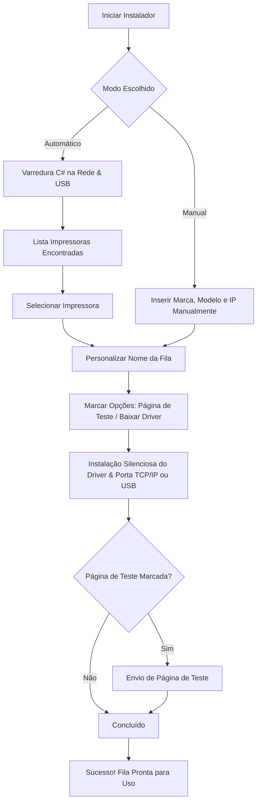

# 🖨️ Instalador Inteligente de Impressoras - TI Prefeitura

[](https://microsoft.com)
[](https://microsoft.com/powershell)
[](https://dotnet.microsoft.com)
[]()

Utilitário automatizado e inteligente para **localização, configuração e instalação silenciosa de impressoras** em computadores com Windows, com suporte completo a **Rede Local (TCP/IP)** e conexões via **Cabo USB**.

Desenvolvido para agilizar o suporte técnico da TI, padronizar as filas de impressão e eliminar a necessidade de configuração manual repetitiva de IPs, portas e drivers.

---

## 🎯 Principais Funcionalidades

* ⚡ **Descoberta Automática de Alta Velocidade:** Motor em C# multithread (`FastPrinterDiscovery`) que varre a sub-rede local via SNMP/HTTP e as portas USB em poucos segundos sem travar a interface.
* 🌐 **Seleção Inteligente de Sub-rede:** Identifica automaticamente a placa de rede física com gateway ativo (ignorando adaptadores virtuais como VirtualBox e VMware) e oferece um campo editável para selecionar ou digitar a faixa de IP desejada.
* 🏷️ **Personalização do Nome da Impressora:** Sugere nomes organizados por padrão e permite personalização imediata (ex.: *"Canon 1643 - Gabinete"*, *"Epson L6490 - Recepção"*, *"Brother RH"*).
* 📦 **Gerenciamento de Drivers (Offline e Online):** Suporte nativo a repositório local de drivers (arquivos `.inf` instalados via `pnputil`) com opção de download automático caso o pacote não esteja salvo no computador.
* 📄 **Página de Teste Automática:** Envia opcionalmente uma página de teste assim que a instalação é finalizada para validação imediata do funcionamento.
* ⚙️ **Modo Manual Alternativo:** Permite configurar impressoras informando o IP e modelo manualmente, ideal para VLANs segmentadas ou equipamentos temporariamente fora da rede.
* 🛡️ **Execução em 1 Clique (com UAC):** Acompanha executável compilado com manifesto de elevação administrativa, dispensando cliques com o botão direito.

---

## 🖨️ Modelos Homologados

| Fabricante | Modelo | Tipo / Tecnologia | Método de Instalação |
| :--- | :--- | :--- | :--- |
| **Canon** | imageRUNNER 1643iF | Multifuncional Laser Monocromática A4 | Driver INF PCL6 silencioso (`pnputil`) |
| **Canon** | GX7000 / GX7010 | Multifuncional Tanque de Tinta Colorida | Pacote silencioso / INF nativo |
| **Brother** | DCP-L5652DN | Multifuncional Laser Monocromática | Pacote silencioso (`/S`) / INF |
| **Epson** | EcoTank L6490 | Multifuncional Tanque de Tinta Colorida (ADF) | Extração de INF e instalação direta via `pnputil` |

> 💡 *Outros modelos e fabricantes (HP, Kyocera, Lexmark, etc.) podem ser facilmente adicionados ao catálogo editando a lista de modelos do script.*

---

## 🚀 Como Utilizar

### Requisitos Mínimos:
* Windows 10, Windows 11 ou Windows Server (64-bit ou 32-bit).
* PowerShell 5.1 ou superior (já nativo no Windows).
* Privilégios de Administrador local.

---

### Opções de Inicialização:

#### Opção 1: Executável Direto (Recomendado)
Dê um duplo clique no inicializador:
```text
InstaladorImpressoras.exe
```
> O executável já solicita a elevação de Administrador (UAC) e abre a interface gráfica moderna em WPF.

#### Opção 2: Iniciador em Lote (Batch)
Execute o arquivo:
```text
Iniciar.bat
```

#### Opção 3: Via PowerShell
Abra o PowerShell como Administrador e execute:
```powershell
Set-Location "C:\Impressora IT (Útil)"
powershell.exe -ExecutionPolicy Bypass -File .\InstaladorImpressoras.ps1
```

---

## 🖥️ Fluxo de Uso e Instalação



1. **Localização:** O instalador detecta a sub-rede ativa e lista as impressoras disponíveis na rede ou conectadas via USB.
2. **Personalização:** Escolha a impressora detectada e defina o nome com o setor ou sala de destino.
3. **Instalação:** Clique em **"INSTALAR AGORA"**. O driver é publicado, a porta TCP/IP (RAW 9100) ou USB é criada, e a impressora é disponibilizada no sistema.

---

## 📁 Estrutura do Repositório

```text
c:\Impressora IT (Útil)\
│
├── InstaladorImpressoras.exe     # Lançador compilado C# com manifesto UAC (execução em 1 clique)
├── Iniciar.bat                   # Script em lote alternativo para execução rápida
├── InstaladorImpressoras.ps1     # Script principal com interface gráfica WPF e rotinas de instalação
├── Baixar-Drivers.ps1            # Script auxiliar para verificação e download prévio de pacotes
├── LEIA-ME.txt                   # Manual e guia rápido em texto puro
├── README.md                     # Documentação completa do projeto
│
├── Drivers\                      # Repositório de drivers offline organizados por fabricante
│   ├── Brother\
│   │   └── DCPL5652DN\
│   ├── Canon\
│   │   ├── GX7000\
│   │   ├── GX7010\
│   │   └── iR1643iF\
│   └── Epson\
│       └── L6490\
│
└── src\                          # Códigos-fonte e módulos de apoio
    ├── FastPrinterDiscovery.cs   # Motor C# para escaneamento assíncrono de rede (SNMP/HTTP) e USB
    ├── FastPrinterDiscovery.dll  # Biblioteca compilada do motor de descoberta
    ├── Launcher.cs               # Código-fonte do executável inicializador
    └── app.manifest              # Manifesto Windows com solicitação de privilégios de Administrador
```

---

## 🔧 Como Adicionar Novos Modelos e Drivers

1. **Adicionar os arquivos de driver:**
   * Crie uma pasta dentro de `Drivers\<Fabricante>\<Modelo>\`.
   * Coloque os arquivos `.inf`, `.cat` e `.sys` descompactados dentro dessa pasta (ou o instalador executável silencioso).

2. **Registrar no Catálogo:**
   * Abra o arquivo [`InstaladorImpressoras.ps1`](InstaladorImpressoras.ps1).
   * Localize o bloco `$Impressoras = [ordered]@{ ... }` e adicione a nova marca e modelo:
     ```powershell
     "HP" = [ordered]@{
         "LaserJet Pro M404" = @{
             Pasta        = "M404"
             DriverNames  = @("HP LaserJet Pro M404-M405 PCL-6")
             Installer    = ""
             SilentArgs   = ""
             Descricao    = "Impressora Laser Monocromática A4"
             DownloadUrl  = "https://support.hp.com"
         }
     }
     ```

3. **Verificar os Drivers com o Script Auxiliar:**
   * Execute o script [`Baixar-Drivers.ps1`](Baixar-Drivers.ps1) para validar se os arquivos `.inf` foram reconhecidos corretamente na pasta local.

---

## ⏳ Intuito da criação do programa

Desenvolvido para otimização de tempo de equipes de manutenção e TI.
